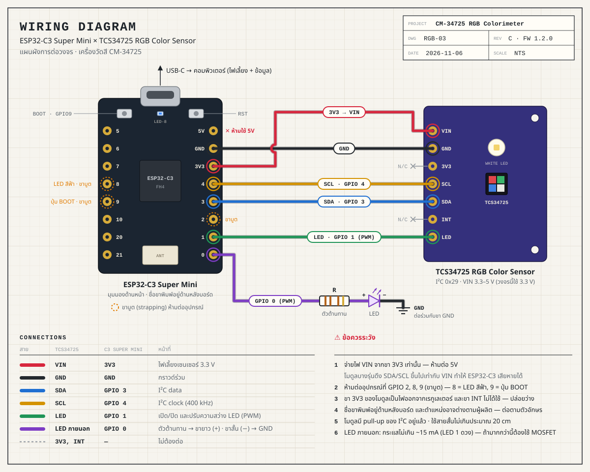

# CM-34725 RGB Colorimeter

เครื่องวัดสีด้วย **ESP32-C3 Super Mini + TCS34725** เชื่อมต่อกับหน้าเว็บไฟล์เดียว (`index.html`) ผ่าน **Bluetooth (BLE)** หรือ **สาย USB** ได้ทั้งสองทาง

```
project_RGB/
├── index.html                    ← เว็บแอป (ไฟล์เดียว ไม่ต้องติดตั้งอะไร)
├── wiring.svg                    ← แผนผังการต่อวงจร (เปิดด้วยเบราว์เซอร์/สั่งพิมพ์ได้)
└── firmware/RGBMeter/RGBMeter.ino ← โค้ดสำหรับ ESP32-C3 (ใช้กับ ESP32-S3 Super Mini ได้ด้วย เลือกขาให้อัตโนมัติ)
```

## ความสามารถ

| หมวด | รายละเอียด |
|---|---|
| ค่าที่อ่าน | R, G, B, C (Clear) แบบ raw count, % ของค่าอิ่มตัว, ส่วนเบี่ยงเบนมาตรฐาน (σ) และ CV% |
| สี | HEX, sRGB, HSV, HSL, CIE L\*a\*b\*, CIE xy, ชื่อสีที่ใกล้ที่สุด (ไทย/อังกฤษ) |
| แสง | Illuminance (lux), อุณหภูมิสี CCT (DN40 และ McCamy), ค่า IR, พิกัดสีของแหล่งกำเนิดแสง |
| เปรียบเทียบสี | ตั้งสีอ้างอิง แล้วดู ΔE₀₀ (CIEDE2000) แบบเรียลไทม์ |
| ควบคุม | เปิด/ปิด LED, ปรับความสว่าง LED (PWM), Gain 1/4/16/60×, Integration time 2.4–614 ms, **Auto-range**, อัตราส่งข้อมูล, Stop/Run, วัดครั้งเดียว, Hold |
| Calibration | DARK (หักแสงรบกวน — ระบบปิด LED ให้อัตโนมัติ), WHITE (white balance) |
| กราฟ | Time series (Raw / Signal / Absorbance), แผนภาพ CIE 1931 พร้อม Planckian locus |
| เคมี/ชีววิทยา | โหมด **Absorbance** (A = −log₁₀ I/I₀), **กราฟมาตรฐาน Beer–Lambert** (linear regression, R²) และคำนวณความเข้มข้นของสารที่ไม่ทราบค่า |
| บันทึกข้อมูล | Data log แบบต่อเนื่อง (REC) หรือทีละค่า (Capture) พร้อม label → Export CSV (เปิดใน Excel ได้) |
| อื่น ๆ | ไฟสีฟ้าบนบอร์ดกะพริบทุกครั้งที่ส่งข้อมูล, บันทึกค่าตั้งลงบอร์ด, ปุ่ม BOOT เปิด/ปิด LED, Console พิมพ์คำสั่งเอง, โหมด Demo ไม่ต้องมีอุปกรณ์ |

## 1. ต่อสาย



| TCS34725 | ESP32-C3 Super Mini |
|---|---|
| VIN | 3V3 |
| GND | GND |
| SDA | GPIO 3 |
| SCL | GPIO 4 |
| LED | GPIO 1 |
| INT | ไม่ต้องต่อ |
| 3V3 (บนโมดูล) | ไม่ต้องต่อ — เป็นไฟออกจากเรกูเลเตอร์ |

> ⚠ จ่ายไฟ VIN จาก **3V3 เท่านั้น ห้ามใช้ 5V** — โมดูลบางรุ่นดึงสาย SDA/SCL ขึ้นไปเท่ากับ VIN ซึ่งทำให้ ESP32-C3 เสียหายได้
> ⚠ **ห้ามต่ออุปกรณ์ที่ GPIO 2, 8, 9** — เป็นขาที่ชิปอ่านค่าตอนบูต (strapping) ถ้าถูกดึงผิดระดับบอร์ดจะบูตไม่ขึ้น (GPIO 8 = ไฟสีฟ้าบนบอร์ด, GPIO 9 = ปุ่ม BOOT) ตัวอย่างโค้ดทั่วไปใช้ I²C ที่ขา 8/9 แต่โปรเจคนี้ย้ายมาใช้ 3/4 แทน
>
> ชื่อขาของ C3 Super Mini พิมพ์อยู่ **ด้านหลังบอร์ด** และตำแหน่งอาจต่างกันตามผู้ผลิต ให้ต่อตามตัวอักษรบนบอร์ด
> เปลี่ยนขาได้ที่หัวไฟล์ `RGBMeter.ino` (`PIN_SDA`, `PIN_SCL`, `PIN_SENSOR_LED`)

## 2. อัปโหลด Firmware (Arduino IDE 2)

1. **Boards Manager** → ติดตั้ง **esp32 by Espressif Systems** (เวอร์ชัน 2.0.x หรือ 3.x ใช้ได้ทั้งคู่)
2. เปิดไฟล์ `firmware/RGBMeter/RGBMeter.ino` — ไม่ต้องติดตั้ง library เพิ่ม (ใช้ Wire, BLE, Preferences ที่มากับบอร์ด)
3. ตั้งค่าเมนู **Tools**

   | เมนู | ค่า |
   |---|---|
   | Board | **ESP32C3 Dev Module** |
   | USB CDC On Boot | **Enabled** (สำคัญ — ไม่งั้นต่อ USB กับเว็บไม่ได้) |
   | Flash Size | 4MB |
   | Partition Scheme | **Huge APP (3MB No OTA/1MB SPIFFS)** (BLE ใช้พื้นที่มาก) |

   > ถ้าเปลี่ยนไปใช้ ESP32-S3 Super Mini ให้เลือก Board = ESP32S3 Dev Module — firmware จะสลับไปใช้ขา SDA 8 / SCL 9 / LED 7 และไฟ RGB GPIO 48 ให้เอง

4. กด Upload — ถ้าอัปโหลดไม่ผ่าน: กดปุ่ม **BOOT** ค้าง → กด **RST** → ปล่อย BOOT แล้วอัปโหลดใหม่ (หลังอัปโหลดเสร็จกด RST หนึ่งครั้ง)
5. ทดสอบ: เปิด Serial Monitor (115200) พิมพ์ `INFO` ควรได้ `I,RGBMeter,1.1.0,0x44,RGBMeter-XXXX,C3`

## 3. ใช้งานเว็บแอป

- เปิด `index.html` ด้วย **Google Chrome** หรือ **Microsoft Edge** บนคอมพิวเตอร์ (Windows / macOS / Linux / ChromeOS)
- **USB** → เลือกพอร์ตของบอร์ด · **BLE** → เลือก `RGBMeter-XXXX`
- ถ้าปุ่มขึ้นว่าไม่รองรับ ให้เปิดผ่าน local server แทนการดับเบิลคลิก:
  ```bash
  cd project_RGB
  python3 -m http.server 8000
  # แล้วเปิด http://localhost:8000
  ```
  หรือวางไฟล์ไว้บน GitHub Pages (https) ก็ใช้ได้
- Android (Chrome) ใช้ได้เฉพาะ BLE · iPhone/iPad ใช้แอป **Bluefy** เพื่อเชื่อม BLE
- ไม่มีอุปกรณ์? กด **Demo** หรือเปิด `index.html?demo`

### ขั้นตอนวัดสีวัตถุ

1. ติดเซนเซอร์ให้ห่างจากวัตถุคงที่ (แนะนำ 3–10 มม. และกันแสงรอบข้างด้วยปลอกทึบแสง)
2. กด **DARK** (ระบบปิด LED → วัดแสงรบกวน → เปิด LED คืนให้อัตโนมัติ)
3. วางกระดาษขาว/แผ่นอ้างอิงสีขาว กด **WHITE** → ป้ายมุมขวาบนจะเปลี่ยนเป็น `WB CAL`
4. วางวัตถุ อ่านค่าสี · กด **Set REF** แล้วเปลี่ยนวัตถุเพื่อดู ΔE₀₀

> ถ้าแถบ meter เกินเส้นแดงหรือมีป้าย **SATURATED** ให้ลด Gain / Integration time / ความสว่าง LED หรือเปิด **Auto-range**

### ขั้นตอนหาความเข้มข้นสารละลาย (Beer–Lambert)

1. ปิด Auto-range และตั้ง Gain/Integration ให้ค่า C ประมาณ 40–80 % sat ตอนวัด blank
2. แท็บ **Absorbance** → ใส่ cuvette ตัวทำละลายเปล่า → กด **BLANK (I₀)**
3. ใส่สารมาตรฐานทีละความเข้มข้น → พิมพ์ค่าความเข้มข้น → **+ Add standard**
4. เลือก **Channel** ที่ค่า A เปลี่ยนมากที่สุด (แถวสีส้มในตาราง มักเป็นสีคู่ตรงข้ามของสารละลาย) ดูค่า R² ควร ≥ 0.99
5. ใส่สารตัวอย่าง → ช่อง **Unknown** แสดงความเข้มข้นที่คำนวณได้ (มี ⚠ ถ้าอยู่นอกช่วงสารมาตรฐาน)

ค่า calibration, blank, สีอ้างอิง และสารมาตรฐาน ถูกจำไว้ในเบราว์เซอร์ (localStorage) เปิดหน้าใหม่ก็ยังอยู่

### คีย์ลัด

`L` เปิด/ปิด LED · `M` วัดหนึ่งครั้ง · `H` Hold · `R` ตั้งสีอ้างอิง · `Space` บันทึกค่าลง Data log

## 4. Protocol (ใช้ได้ทั้ง USB Serial และ BLE)

BLE ใช้ **Nordic UART Service** (`6E400001-B5A3-F393-E0A9-E50E24DCCA9E`) จึงทดสอบด้วยแอป nRF Connect / Serial Bluetooth Terminal ได้ด้วย ทุกข้อความเป็นบรรทัดข้อความ จบด้วย `\n`

**อุปกรณ์ → เว็บ**

| บรรทัด | ความหมาย |
|---|---|
| `D,r,g,b,c,atime,gain,n` | ค่า raw เฉลี่ยจาก n รอบการวัด |
| `S,led=1,pwr=100,gain=4,atime=192,agc=0,rate=100,stream=1,pix=0` | สถานะปัจจุบัน (ส่งทุกครั้งที่มีการเปลี่ยน) |
| `I,RGBMeter,<fw>,<sensor id>,<ชื่อ BLE>,<C3\|S3>` | ข้อมูลอุปกรณ์ |
| `E,<code>,<รายละเอียด>` | ข้อผิดพลาด เช่น `SENSOR_NOT_FOUND` |

**เว็บ → อุปกรณ์**

| คำสั่ง | ผล |
|---|---|
| `LED 0` / `LED 1` / `LED T` | ปิด / เปิด / สลับ LED |
| `PWR 0-100` | ความสว่าง LED (%) |
| `GAIN 1\|4\|16\|60` | อัตราขยาย (ปิด auto-range) |
| `IT <ms>` หรือ `ATIME <0-255>` | Integration time 2.4–614.4 ms (ATIME = 256 − ms/2.4) |
| `AGC 0\|1` | Auto-range |
| `RATE <ms>` | ช่วงเวลาส่งข้อมูล (firmware เฉลี่ยทุกรอบในช่วงนั้น, 0 = ส่งทุกรอบ) |
| `STREAM 0\|1` | หยุด/เริ่มส่งข้อมูลต่อเนื่อง |
| `READ` | วัดใหม่หนึ่งครั้ง |
| `PIX OFF` / `PIX AUTO` / `PIX r g b` | ไฟ RGB บนบอร์ด (เฉพาะ S3 Super Mini) |
| `SAVE` / `DEFAULTS` / `INFO` / `STATE` | บันทึกค่าตั้งลงบอร์ด / คืนค่าเริ่มต้น / ข้อมูล / ขอสถานะ |

## 5. แก้ปัญหา

| อาการ | วิธีแก้ |
|---|---|
| `SENSOR_NOT_FOUND` | ตรวจสาย SDA (GPIO 3) / SCL (GPIO 4) สลับกันหรือไม่, VIN ต่อ 3V3, ตรวจขาใน `RGBMeter.ino` |
| บอร์ดบูตไม่ขึ้น / อัปโหลดไม่ได้หลังต่อสาย | ตรวจว่าไม่มีสายต่อที่ GPIO 2, 8, 9 (ขาบูต) |
| กด USB แล้วไม่เห็นพอร์ต | ตั้ง **USB CDC On Boot = Enabled** แล้วอัปโหลดใหม่, ใช้สาย USB ที่ส่งข้อมูลได้ (ไม่ใช่สายชาร์จอย่างเดียว) |
| พอร์ตถูกใช้งานอยู่ | ปิด Serial Monitor ของ Arduino IDE ก่อน (ใช้พอร์ตพร้อมกันไม่ได้) |
| ไม่เจออุปกรณ์ BLE / หลุดบ่อย | เปิด Bluetooth ของคอมพิวเตอร์, ถอดการเชื่อมต่อจากแอปอื่น, กด RST บนบอร์ด · เสาอากาศของ C3 Super Mini เล็ก ควรวางห่างคอมพิวเตอร์ไม่เกิน 2–3 เมตร หรือใช้สาย USB แทน |
| อัปโหลดแล้ว error "Sketch too big" | ตั้ง Partition Scheme = Huge APP |
| LED ไม่ติด/ไม่ดับ | ตรวจว่าขา LED ของโมดูลต่อ GPIO 1, โมดูลบางรุ่นต้องดึง LED ลง LOW เพื่อดับ (firmware ทำให้แล้ว) |

## หมายเหตุด้านความแม่นยำ

- สีที่แสดงเป็น **ค่าสัมพัทธ์กับแผ่นขาวอ้างอิง** (ต้อง Calibrate WHITE) ไม่ใช่เครื่องวัดสีมาตรฐานที่สอบเทียบแล้ว
- Lux และ CCT คำนวณตามเอกสาร AMS DN40 / DN25 เป็นค่าประมาณ ควรวัดตอน **ปิด LED** (วัดแสงแวดล้อม)
- TCS34725 วัดได้ 3 ช่องสี (ไม่ใช่ spectrophotometer) — โหมด Absorbance เหมาะกับสารละลายที่ดูดกลืนแสงในช่วงสีของช่องที่เลือก
